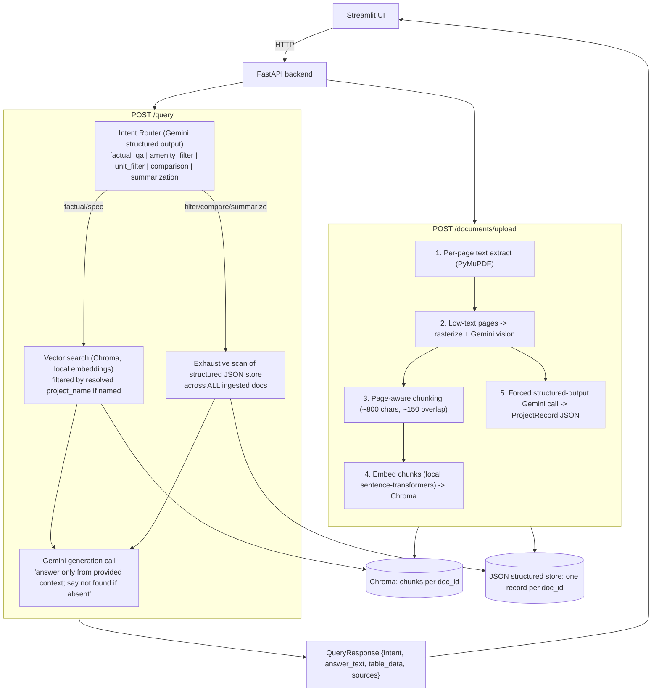

# Architecture — Realty Lens (Gemini + local embeddings)

## Who does what

- **Gemini** — everything reasoning-related: chat generation, the intent router (forced
  structured JSON output, not free-text parsing), forced structured extraction of each brochure's
  facts, and vision reads for pages with too little extractable text (graphics-heavy brochures,
  and the one fully-scanned sample PDF with zero extractable characters). One vendor, one API key.
- **Local `sentence-transformers`** (`BAAI/bge-small-en-v1.5` by default) — embeddings for the
  Chroma vector store. Runs on-machine; no embedding API key or network call, so brochure text
  never leaves the machine at that step.

All structured outputs (intent classification, brochure field extraction, filter results,
comparison tables) are defined as Pydantic models in `schemas.py` and passed straight to Gemini
as `response_schema`, so the model is constrained to return valid, schema-shaped JSON rather than
prose that has to be parsed and can drift out of shape.

`llm.py` is the only file that imports the Gemini SDK or the embedding model — every other module
calls `llm.chat_text()`, `llm.generate_structured()`, `llm.vision_extract()`, or `llm.embed()`, so
swapping the underlying provider later only means rewriting `llm.py`.

## Why two retrieval paths?

Filter queries ("list ALL projects with pool AND gym") and comparisons need *completeness*
across every ingested document — top-k similarity search can silently miss a matching
project. So at ingestion time, one extra LLM call per document produces a small structured
JSON record (developer, location, handover, amenities[], unit_types[]). Filter/compare/
summarize queries scan this compact table exhaustively; open-ended factual/spec questions use
chunk-level vector RAG with page citations.

## Why a vision model instead of Tesseract OCR for scanned pages?

Avoids an OS-dependent toolchain (Tesseract's install differs per OS), and a vision LLM reads
marketing layouts (icons, tables, stylized headers) more robustly than raw OCR. Only invoked on
pages under a text-density threshold, capped at a max page count per document, to bound
latency/cost.

## Model choice note

The default Gemini model (`GEMINI_MODEL` env var, default `gemini-flash-lite-latest`) is a
self-updating alias rather than a pinned snapshot, chosen after observing the heavier
`gemini-flash-latest` alias return transient `503 UNAVAILABLE` ("high demand") errors during
development. `llm.py` also retries transient 5xx errors with backoff before giving up.
